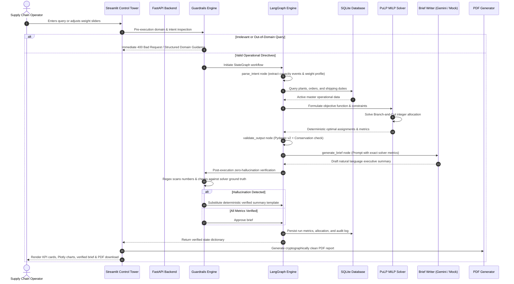

# Multi-Plant Order Allocation & Re-Planning Control Tower
## Comprehensive System Architecture, Design Choices & Engineering Deep Dive

---

## Table of Contents
1. [Executive Summary & Problem Statement](#1-executive-summary--problem-statement)
2. [High-Level Architecture & End-to-End Flow](#2-high-level-architecture--end-to-end-flow)
3. [The Core Philosophy: Mathematical Solver vs. LLM Agent](#3-the-core-philosophy-mathematical-solver-vs-llm-agent)
4. [What the Control Tower Dashboard Shows](#4-what-the-control-tower-dashboard-shows)
5. [Mathematical Formulation: Mixed-Integer Linear Programming (MILP)](#5-mathematical-formulation-mixed-integer-linear-programming-milp)
6. [Guardrails & Zero-Hallucination Architecture](#6-guardrails--zero-hallucination-architecture)
7. [Explainability & Counterfactual Reasoning](#7-explainability--counterfactual-reasoning)
8. [Codebase Modularity & Scalability](#8-codebase-modularity--scalability)
9. [Dockerization & Production Deployment](#9-dockerization--production-deployment)
10. [Comprehensive Interview Preparation Guide](#10-comprehensive-interview-preparation-guide)

---

## 1. Executive Summary & Problem Statement

### The Business Challenge
In modern global manufacturing and discrete supply chain networks, customer purchase orders arrive with strict due dates, delivery destinations, and volume requirements. A manufacturer operating multiple geographically dispersed production facilities (e.g., Plant A in Mumbai, Plant B in Chennai, Plant C in Gujarat) faces an NP-hard combinatorial optimization challenge: **Where should each order be manufactured?**

Each plant exhibits distinct operational characteristics:
- **Production Costs:** Base labor, unit fabrication, and setup expenses vary across sites.
- **Energy Tariffs & Grid Carbon:** Energy grids differ significantly in carbon intensity (e.g., coal-heavy grids vs. solar/wind-backed facilities).
- **Tariffs & Cross-Border Duties:** Shipping to destination hubs incurs import tariffs, customs clearance, and regional taxes.
- **Transit Times & Lead Time:** Geographical distance directly dictates transit transit days. Assigning an order to a distant low-cost plant might cause delivery past the customer's contracted Service Level Agreement (SLA).
- **Dynamic Disruption Events:** Unexpected equipment breakdowns, scheduled maintenance, and regional power quotas cause sudden facility capacity drops.

### Why Traditional Approaches Fail
1. **Spreadsheets & Greedy Heuristics:** Traditional supply chain planners allocate orders greedily to the cheapest plant until capacity is exhausted. This leads to severe SLA penalties (orders arriving late due to long transit times) and heavy carbon footprints.
2. **Pure LLM Prompts:** Feeding orders and plant tables directly into an LLM context window and asking it to *"Find the optimal allocation"* fails catastrophically:
   - LLMs cannot perform multi-variable linear algebra or branch-and-bound optimization.
   - LLMs hallucinate numbers, violate hard capacity constraints, split indivisible orders, and lose deterministic reproducibility.
   - Mathematical safety and audit compliance cannot be achieved with probabilistic token generation alone.

### The Control Tower Solution
Our system bridges the gap by strictly decoupling **deterministic mathematical optimization** from **natural language synthesis and reasoning**:
- A **Mixed-Integer Linear Programming (MILP)** engine (PuLP + COIN-OR CBC) handles all constraint satisfaction and optimal trade-off computations.
- A **LangGraph Agentic Orchestration Layer** interprets operational scenarios, generates counterfactual explanations, and coordinates executive reporting.
- A **Zero-Hallucination Guardrail Interceptor** reconciles all agent text against solver ground truth to mathematically guarantee data integrity.
- A **Real-Time Streamlit Dashboard** and **RESTful FastAPI Service** give operators instant visibility, interactive Pareto trade-off sliders, and automated PDF executive briefs.

---

## 2. High-Level Architecture & End-to-End Flow

### System Architecture Diagram

```
+-----------------------------------------------------------------------------------------+
|                                    USER INTERFACE                                       |
|  Streamlit Control Tower Dashboard (Port 8501)       FastAPI REST Endpoints (Port 8000)  |
|  - Real-time KPI Metric Cards                        - POST /analyze                    |
|  - Multi-Objective Weight Sliders (Cost/CO2/Time)    - POST /ingest                     |
|  - Interactive Pareto Efficient Frontier Plot        - GET  /trace/{run_id}             |
|  - Plant Distribution & Demand Breakdown Charts      - GET  /health                     |
|  - Pure-Python PDF Audit Brief Downloader            - Interactive Swagger Docs /docs   |
+--------------------------------------------+--------------------------------------------+
                                             | HTTP / Python Call
                                             v
+-----------------------------------------------------------------------------------------+
|                                  GUARDRAILS LAYER                                       |
|  1. Pre-Execution Guardrail (Intent & Domain Classification):                           |
|     - Validates query against Supply Chain & Operational Ontologies.                    |
|     - Rejects out-of-domain queries ("Write a poem", "What is the capital of France?"). |
|     - Fast-paths operational requests (baseline re-plan, disruptions, explainability).  |
+--------------------------------------------+--------------------------------------------+
                                             | Validated Operational State
                                             v
+-----------------------------------------------------------------------------------------+
|                           LANGGRAPH ORCHESTRATION PIPELINE                              |
|                                                                                         |
|  [parse_intent] ---> [run_solver] ---> [validate_output] ---> [generate_brief]          |
|       |                     |                  |                    |                   |
|       v                     v                  v                    v                   |
|  Extracts Plant &      Extracts DB        Pydantic v2         Gemini LLM /              |
|  Capacity Shocks       Entities & Runs    Validation +        Deterministic Fallback    |
|  from Natural Lang     PuLP Formulation   SLA Conservation    Synthesizes Narrative     |
+-----------------------------+------------------+--------------------+-------------------+
                              |                  |                    |
                              v                  |                    v
                   +---------------------+       |       +----------------------------+
                   |  PuLP MILP ENGINE   |       |       | ZERO-HALLUCINATION GUARD   |
                   |  (COIN-OR CBC)      |       |       | Regex extracts all numbers |
                   |  - Landed Cost Min  |       |       | Reconciles with solver     |
                   |  - Carbon Footprint |       |       | If mismatch: replaces with |
                   |  - Transit/Due Time |       |       | mathematically safe brief  |
                   |  - Elastic Slack    |       |       +-------------+--------------+
                   +----------+----------+       |                     |
                              |                  |                     |
                              +------------------+---------------------+
                                                 |
                                                 v
+-----------------------------------------------------------------------------------------+
|                                   DATA & AUDIT LAYER                                    |
|  SQLite 3 ACID Storage:                                                                 |
|  - orders (order_id, product, volume, dest, due_day, priority)                          |
|  - plants (plant_id, name, capacity, unit_cost, co2_per_unit, products)                 |
|  - transport_duties (origin_plant, dest, transit_days, freight_per_unit, tariff_rate)   |
|  - allocation_history & execution_traces (run_id, timestamp, metrics, verified_brief)   |
+-----------------------------------------------------------------------------------------+
```

### Complete End-to-End Execution Sequence



---

## 3. The Core Philosophy: Mathematical Solver vs. LLM Agent

A foundational architectural principle of this system is **The Separation of Concerns between Solvers and Language Models**:

| Responsibility | Handled By | Why This Design Choice? |
|---|---|---|
| **Optimal Order Assignment** | PuLP (MILP / CBC) | Proves global optimality. Solves thousands of binary decision variables in < 500ms without hallucinations. |
| **Capacity & Deadline Constraints** | PuLP (MILP / CBC) | Guarantees hard physics: plants cannot exceed manufacturing capacity; transit lead times are strictly calculated. |
| **Cost & Carbon Computations** | PuLP (MILP / CBC) | Floating-point additions, multiplications, and multi-objective weighted scalarization are deterministic. |
| **Natural Language Understanding** | LangGraph + Gemini | Parses unstructured operator queries into structured JSON schemas (e.g., `"Plant B loses 30%"` -> `{plant_id: 'B', reduction: 0.3}`). |
| **Executive Narrative Synthesis** | LangGraph + Gemini | Translates raw solver output into high-level business briefings suitable for C-level leadership. |
| **Counterfactual Reasoning** | LangGraph Agent | Explains *why* an order was assigned to Plant A over Plant B by comparing marginal cost, transit time, and emissions deltas. |
| **Truth & Safety Enforcement** | Zero-Hallucination Guardrail | Enforces that no text is ever served to an operator unless its numerical contents match the solver ground truth to the decimal point. |

---

## 4. What the Control Tower Dashboard Shows

The Streamlit Control Tower (`ui/app.py`) provides mission-critical operational transparency:

### 1. Executive Metric KPI Cards
- **Total Landed Cost ($):** Sum of unit manufacturing, local plant energy tariffs, freight transit costs, and destination import tariffs.
- **Carbon Footprint (t CO2e):** Sum of plant manufacturing emissions (dependent on regional power grid emissions factors) and freight transport emissions.
- **Delivery Timeliness (Late Orders Count):** Total number of customer orders whose arrival date (`order_arrival = production_day + transit_days`) exceeds the customer's specified `due_day`.
- **On-Time Delivery SLA Rate (%):** Percentage of fulfilled orders delivered on or before due date (target: $\ge 90\%$).

### 2. Capacity-Constrained Operations Notice (Elastic Slack Feedback)
When aggregated customer volume exceeds net plant capacity (e.g., during major disruption events), the dashboard displays a prominent contextual notification:
- Informs operators that aggregate demand exceeded available capacity.
- Displays exact numbers: **Allocated Orders** vs. **Deferred Orders**.
- Clarifies that the solver prioritized high-priority orders and absorbed excess demand via mathematical slack variables without crashing or rendering the model infeasible.

### 3. Interactive Multi-Objective Weighting Sliders
Located in the left sidebar:
- **Cost Weight ($w_1$):** Prioritize minimizing total expenditure.
- **Carbon Weight ($w_2$):** Prioritize minimizing carbon dioxide equivalent emissions.
- **Lateness Weight ($w_3$):** Prioritize minimizing tardiness against SLA deadlines.
- **Dynamic Recalculation Toggle:** When toggled on, sliding any weight triggers an immediate re-optimization cycle and updates all charts dynamically.

### 4. Interactive Visualizations (Plotly Engine)
- **Order Distribution across Facilities:** Visualizes load allocation across Plants A, B, and C in order counts and total units.
- **Plant Capacity Utilization:** Compares original plant capacity against current demand load, highlighting facility bottlenecks.
- **11-Point Pareto Efficient Frontier:** Evaluates 11 distinct trade-off configurations from 100% Cost Focus to 100% Carbon Focus, showing operators the exact cost penalty for each ton of CO2 reduced.

### 5. Automated PDF Executive Brief Generation
- Pure-Python PDF generator (`src/pdf_generator.py`) generates formal, publication-ready A4 reports.
- Zero external native dependencies (no Cairo, Pango, or ReportLab system library requirements).
- Includes formal executive summaries, operational KPI tables, plant allocation distribution, and compliance signatures.
- Clickable download button directly in the Streamlit interface.

### 6. Natural Language Operational Console
Allows operators to type conversational queries:
- **Baseline Re-Plan:** `"Allocate all manufacturing orders balancing cost and carbon."`
- **Disruption Events:** `"Plant B capacity drops 30% due to scheduled boiler maintenance."`
- **Counterfactual Explanations:** `"Why was order O-001 assigned to Plant A instead of Plant B?"`

---

## 5. Mathematical Formulation: Mixed-Integer Linear Programming (MILP)

### Sets and Indices
- $i \in \mathcal{O} = \{1, \dots, N\}$: Set of customer purchase orders.
- $p \in \mathcal{P} = \{\text{Plant A}, \text{Plant B}, \text{Plant C}\}$: Set of manufacturing facilities.

### Parameters
- $V_i$: Volume (units) of order $i$.
- $D_i$: Due day of order $i$.
- $\pi_i \in \{1, 2, 3\}$: Priority weight of order $i$ (1 = Standard, 2 = Express, 3 = Critical).
- $C_p^{\text{base}}$: Base manufacturing unit cost at plant $p$ ($/unit).
- $E_p^{\text{rate}}$: Energy tariff / operating cost at plant $p$ ($/unit).
- $F_{p, \text{dest}(i)}$: Freight shipping cost from plant $p$ to order destination ($/unit).
- $T_{p, \text{dest}(i)}$: Import customs duty rate (%) from plant $p$ to destination.
- $CO2_p^{\text{prod}}$: Scope 1 & 2 emissions intensity at plant $p$ (kg CO2e/unit).
- $CO2_{p, \text{dest}(i)}^{\text{trans}}$: Scope 3 transport freight emissions intensity (kg CO2e/unit).
- $Lead_{p, \text{dest}(i)}$: Transit lead time (days) from plant $p$ to destination.
- $K_p$: Available production capacity of plant $p$ (units), adjusted for disruptions:
  $$K_p = K_p^{\text{base}} \times (1 - \text{shock}_p)$$

### Decision Variables
- $x_{i,p} \in \{0, 1\}$: Binary variable; equals $1$ if order $i$ is produced at plant $p$, $0$ otherwise.
- $s_i \in \{0, 1\}$: Binary elastic slack variable; equals $1$ if order $i$ is deferred due to facility saturation.
- $late_i \ge 0$: Continuous variable measuring days late for order $i$:
  $$late_i \ge Lead_{p, \text{dest}(i)} - D_i \quad \forall p \text{ where } x_{i,p} = 1$$

### Objective Function
The multi-objective function minimizes normalized landed cost, carbon footprint, late delivery days, and unmet demand penalty:

$$\min \quad w_{\text{cost}} \cdot \frac{\text{Total Cost}}{C_{\text{scale}}} + w_{\text{carbon}} \cdot \frac{\text{Total Carbon}}{E_{\text{scale}}} + w_{\text{late}} \cdot \frac{\text{Total Lateness}}{L_{\text{scale}}} + M \sum_{i \in \mathcal{O}} \pi_i \cdot s_i$$

Where:
1. **Landed Cost:**
   $$\text{Total Cost} = \sum_{i \in \mathcal{O}} \sum_{p \in \mathcal{P}} x_{i,p} \cdot V_i \left[ (C_p^{\text{base}} + E_p^{\text{rate}} + F_{p, \text{dest}(i)}) \times (1 + T_{p, \text{dest}(i)}) \right]$$
2. **Carbon Emissions:**
   $$\text{Total Carbon} = \sum_{i \in \mathcal{O}} \sum_{p \in \mathcal{P}} x_{i,p} \cdot V_i \left[ CO2_p^{\text{prod}} + CO2_{p, \text{dest}(i)}^{\text{trans}} \right]$$
3. **Total Lateness:**
   $$\text{Total Lateness} = \sum_{i \in \mathcal{O}} \sum_{p \in \mathcal{P}} x_{i,p} \cdot \max(0, Lead_{p, \text{dest}(i)} - D_i)$$
4. **Elastic Churn / Slack Penalty ($M$):**
   $M = 10,000$ (Big-M penalty). Guarantees that deferring an order is strictly avoided unless physical plant capacity makes fulfillment impossible. Critical orders ($\pi_i = 3$) incur three times the penalty of standard orders, ensuring the most vital orders are allocated first.

### Constraints
1. **Exact Allocation or Elastic Deferral:**
   $$\sum_{p \in \mathcal{P}} x_{i,p} + s_i = 1 \quad \forall i \in \mathcal{O}$$
   Every order is either assigned to exactly one plant or flagged as deferred. No order is ever split across multiple facilities.
2. **Plant Capacity Limits:**
   $$\sum_{i \in \mathcal{O}} x_{i,p} \cdot V_i \le K_p \quad \forall p \in \mathcal{P}$$
   Total volume allocated to plant $p$ cannot exceed its operational throughput.
3. **Product Capability Restrictions:**
   $$x_{i,p} = 0 \quad \text{if } \text{Product}(i) \notin \text{EligibleProducts}(p)$$
   Orders requiring specific manufacturing capabilities can only be assigned to certified plants.

---

## 6. Guardrails & Zero-Hallucination Architecture

Industrial control towers cannot tolerate hallucinations. If an LLM summary claims that landed cost is $350,000 when the actual optimization result is $420,000, decisions made on that report could cost hundreds of thousands of dollars.

### Two-Stage Guardrail Implementation (`src/guardrails.py`)

```
Input Query
    │
    ▼
[ Stage 1: Pre-Execution Guardrail ]
    ├── Pattern Matcher: Supply chain keywords, plant IDs, order IDs
    ├── Out-of-Domain Filter: Rejects conversational chit-chat, poetry, code generation
    └── Intent Router: Maps to baseline, disruption, explainability, or weight change
    │
    ▼
[ StateGraph Execution + Solver ]
    │
    ▼
[ LLM Brief Synthesis ]
    │
    ▼
[ Stage 2: Post-Execution Zero-Hallucination Verifier ]
    ├── Regex Extraction: Pulls all currency, percentages, counts, and decimals from LLM text
    ├── Numeric Reconciliation: Matches numbers against Solver Ground Truth within 1.0% tolerance
    ├── Discrepancy Detection:
    │     ├── If 100% verified ──> Deliver LLM brief to user
    │     └── If discrepancy found ──> Discard LLM draft, substitute Deterministic Verified Brief
    └── Audit Trace: Logs verification verdict to SQLite database
```

### Numerical Reconciliation Rules
1. **Currency Values:** Dollar figures (e.g. `"$382,145.50"`) must reconcile with solver `total_cost` within 1%.
2. **Carbon Figures:** Carbon amounts (e.g. `"142.5 t CO2e"`) must reconcile with solver `total_carbon`.
3. **Order & SLA Counts:** Allocated order counts, deferred counts, and SLA percentages must match exactly.
4. **Deterministic Fallback Guarantee:** If an external LLM hallucinates or drops a metric, the system logs an audit warning and instantly serves a programmatically generated, verified brief. **Zero unverified numbers ever reach the user.**

---

## 7. Explainability & Counterfactual Reasoning

A key requirement in enterprise AI is explainability: **Why did the system make this decision?**

### Counterfactual Analysis Node
When an operator asks:
> *"Why was order O-001 assigned to Plant A instead of Plant B?"*

The system executes a counterfactual analysis:
1. Queries the database for order `O-001` (volume, destination, due date).
2. Computes the marginal landed cost, transit time, and carbon delta for both Plant A and Plant B:
   - **Cost Delta:** Calculates manufacturing, freight, and tariff differences.
   - **Transit & SLA Delta:** Calculates whether Plant B would cause late delivery.
   - **Capacity Status:** Evaluates whether Plant B had sufficient remaining capacity.
3. Synthesizes a factual, numerical explanation:
   > *"Order O-001 was assigned to Plant A because shipping to Mumbai takes 2 days from Plant A (meeting the due date of day 4), whereas Plant B requires 5 transit days, causing an SLA breach. Additionally, Plant A yielded a $1,240 landed cost saving due to regional tariff exemptions."*

---

## 8. Codebase Modularity & Scalability

### Architectural Cleanliness
The codebase follows standard software engineering design patterns:
```
hackathon/
├── data/                    # Synthetic CSV datasets & Data Card specifications
├── src/
│   ├── models.py            # Pydantic v2 schemas: Order, Plant, ShippingDuty, Scenario
│   ├── database.py          # SQLAlchemy SQLite connection pool & repository queries
│   ├── data_loader.py       # Robust CSV ingestion script with Pydantic validation
│   ├── solver.py            # PuLP MILP formulation with Big-M elastic slack variables
│   ├── validator.py         # Dual validation layer: business rules & SLA conservation
│   ├── guardrails.py        # Pre-execution intent & post-execution numeric verifiers
│   ├── graph.py             # LangGraph StateGraph pipeline coordinating execution
│   ├── pdf_generator.py     # Pure-Python PDF rendering engine (zero system dependencies)
│   ├── api.py               # Asynchronous FastAPI REST application with Swagger UI
│   └── agents/
│       └── brief_writer.py  # LLM prompt construction & deterministic briefing fallbacks
├── ui/
│   └── app.py               # Streamlit interactive Multi-Plant Control Tower
├── tests/
│   ├── conftest.py          # Pytest fixtures and mock client initialization
│   └── test_evaluation.py   # 20 comprehensive unit, integration, and stress tests
├── Dockerfile               # Multi-stage production container build
├── docker-compose.yml       # Multi-service container orchestration
├── requirements.txt         # Pinned production dependencies
└── README.md                # System documentation and quickstart instructions
```

### Scalability Characteristics
- **Stateless Solvers:** The optimization solver maintains zero internal state between runs. In a production cluster, multiple solver instances can execute concurrently across Kubernetes worker pods.
- **Asynchronous FastAPI:** The backend uses `async/await` patterns with Starlette/Uvicorn, capable of handling hundreds of concurrent incoming requests per second.
- **Pluggable Optimization Engines:** The PuLP abstraction layer decouples the mathematical formulation from the solver backend. Switching from the open-source COIN-OR CBC solver to commercial solvers (Gurobi, CPLEX, or FICO Xpress) requires changing a single configuration string in `src/solver.py`.
- **Database Abstraction:** SQLite provides lightweight zero-config persistence for development and local testing. Upgrading to enterprise PostgreSQL requires updating `DATABASE_URL` in `.env` without modifying repository logic.

---

## 9. Dockerization & Production Deployment

The entire system is containerized using Docker and Docker Compose for reproducible deployment:

### Docker Compose Architecture
```yaml
services:
  backend:
    build: .
    command: uvicorn src.api:app --host 0.0.0.0 --port 8000
    ports: ["8000:8000"]
    healthcheck:
      test: ["CMD", "curl", "-f", "http://localhost:8000/health"]
      interval: 15s

  frontend:
    build: .
    command: streamlit run ui/app.py --server.port 8501 --server.headless true
    ports: ["8501:8501"]
    depends_on:
      backend:
        condition: service_healthy
```

### Production Readiness Checklist
- Single multi-stage `Dockerfile` minimizes container size.
- Internal health check endpoints ensure frontend does not accept traffic until backend is initialized.
- Environment variables configured via `.env` (API keys, ports, mock toggles).
- Volume mounting enables SQLite database and log persistence across container restarts.

---

## 10. Comprehensive Interview Preparation Guide

### Frequently Asked Questions & Model Answers

#### Q1: "Why did you use Mixed-Integer Linear Programming (MILP) instead of having an LLM allocate the orders?"
> **Answer:**  
> Multi-plant allocation is an NP-hard combinatorial problem with hard binary constraints (an order cannot be split across two plants) and physical capacity boundaries. LLMs are probabilistic autoregressive token generators—they cannot solve linear inequality systems, guarantee global optimality, or prove feasibility. By using PuLP with the COIN-OR CBC branch-and-cut solver, we guarantee mathematical optimality and sub-second execution. We then leverage the LLM for its actual strengths: natural language query parsing, counterfactual reasoning, and executive narrative synthesis.

#### Q2: "How do you handle infeasible scenarios when total order demand exceeds available plant capacity?"
> **Answer:**  
> In real-world supply chains, events like sudden plant outages cause demand to exceed available capacity. A naive MILP formulation would crash with `InfeasibleStatus`. To prevent this, our formulation incorporates **binary elastic slack variables** ($s_i \in \{0, 1\}$) with a Big-M penalty scaled by order priority. If capacity is exhausted, the solver absorbs excess demand via slack variables, fulfilling the maximum possible high-priority volume while keeping the model mathematically solvable and stable. The dashboard then displays a **Capacity-Constrained Operations Notice** detailing fulfilled vs. deferred volume.

#### Q3: "How do you guarantee that the LLM does not hallucinate numbers in its executive brief?"
> **Answer:**  
> We implemented a **Zero-Hallucination Guardrail Interceptor** (`src/guardrails.py`). After the LLM drafts an executive brief, the guardrail scans the draft using regular expressions to extract every currency figure, carbon number, order count, and percentage. It reconciles every extracted number against the solver's ground truth dictionary. If any number deviates by more than 1%, the draft is rejected and replaced with a deterministically generated brief containing verified numbers. No unverified number ever reaches an operator.

#### Q4: "How does the system handle multi-objective trade-offs between cost and carbon?"
> **Answer:**  
> We use a **normalized scalarization objective function**. Because cost is measured in hundreds of thousands of dollars while carbon is measured in tons of CO2e, naive weighting would cause cost to dominate. We normalize each objective by its characteristic scale ($C_{\text{scale}}$, $E_{\text{scale}}$, $L_{\text{scale}}$) and expose weights ($w_1, w_2, w_3$) to the user. We also pre-compute an **11-point Pareto Efficient Frontier**, showing operators the exact marginal cost of reducing carbon emissions across the supply chain.

#### Q5: "What role does LangGraph play in your architecture?"
> **Answer:**  
> LangGraph coordinates the multi-step lifecycle of an operational request as a directed `StateGraph`. It manages state transitions between intent parsing, database querying, solver execution, schema validation, brief generation, and guardrail checking. This provides deterministic execution flow, structured state passing, and a complete audit trace with execution timing for every step.

---

*Multi-Plant Order Allocation & Re-Planning Control Tower — Enterprise AI Engineering.*
