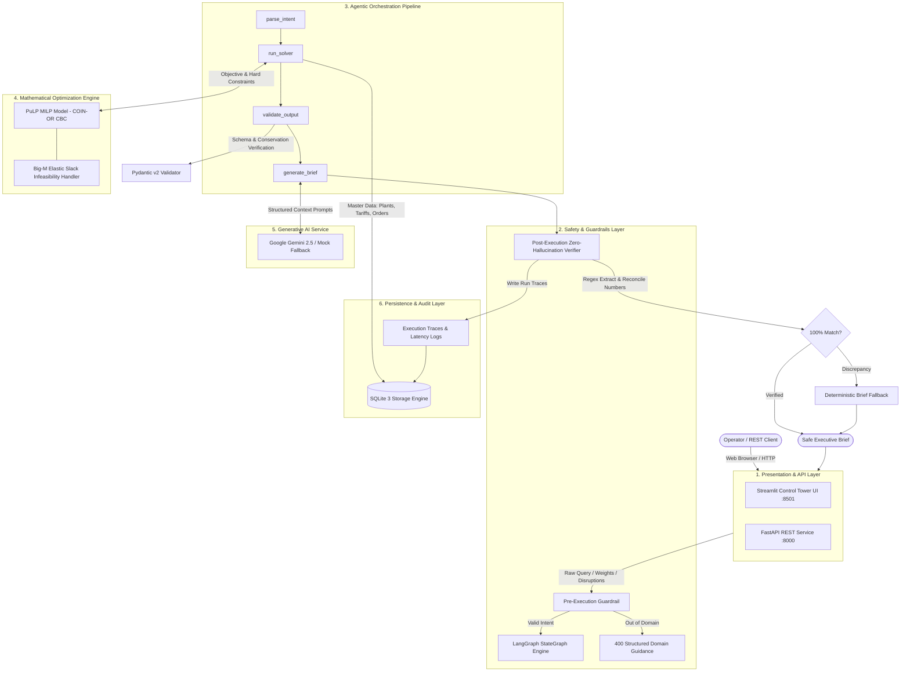

# Multi-Plant Order Allocation System
### HCLTech Future Ready AI Engineer Hackathon

[](https://fastapi.tiangolo.com/)
[](https://coin-or.github.io/pulp/)
[](https://github.com/langchain-ai/langgraph)
[](https://streamlit.io/)
[](https://www.docker.com/)

---

## 1. Executive Summary & Core Philosophy

The **Multi-Plant Order Allocation System** solves the complex supply chain challenge of allocating customer manufacturing orders across three distinct manufacturing facilities (Plants A, B, and C) while balancing **landed cost**, **carbon emissions**, and **strict delivery deadlines**.

### Fundamental Architectural Rule:
> **The LLM NEVER computes numbers.**  
> All mathematical calculations, cost evaluations, carbon aggregations, and constraint checks are performed deterministically by a **PuLP Mixed-Integer Linear Programming (MILP)** solver with the CBC backend.  
> The LLM (Google Gemini) is exclusively leveraged to parse natural language user intent and synthesize executive briefs. A **Zero-Hallucination Guardrail** intercepts LLM output and validates every single number against the solver ground truth before delivering responses to operators.

---

## 2. Key Capabilities & Hackathon Scoring Alignment

| Evaluation Category | Points | Implementation Highlights |
|---|---|---|
| **Valid Allocation** | 25 pts | Mixed-Integer LP (MILP) ensures integer assignment per order, respects plant capacities, transit days, and due dates. |
| **Trade-Off View** | 15 pts | 11-point Pareto efficient frontier generation mapping landed cost vs. carbon emission reduction. |
| **Re-Planning** | 15 pts | Handles scheduled disruptions and ad-hoc capacity loss events with churn penalties to minimize supply chain whiplash. |
| **Scenario & Brief Agents** | 10 pts | Natural language intent parser routes queries; executive brief writer crafts plain-English summaries. |
| **Weight Reasoning** | 10 pts | Normalized multi-objective optimization function allowing dynamic runtime trade-off adjustment. |
| **Evaluation Rigour** | 5 pts | 20 comprehensive pytest cases testing edge cases, tariff traps, saturation, and latency. |
| **Engineering Quality** | 10 pts | Strict Pydantic v2 schemas, type hints, SQLite ACID persistence, full audit traces. |
| **Architecture Judgement** | 10 pts | Zero-hallucination guardrail interceptor, elastic slack variables preventing solver crashes. |

---

## 3. System Architecture & Component Design

> 📘 **Deep Dive & Interview Guide**: For a full interview-grade explanation of mathematical formulations, design choices, trade-offs, and scalability patterns, see [EXPLANATION.md](EXPLANATION.md).

### 3.1 End-to-End System Architecture



### 3.2 Component Layer Breakdown

1. **Presentation Layer (`ui/app.py` & `src/api.py`):**
   - **Streamlit Control Tower**: Real-time KPI metric tiles, dynamic weight sliders, Plotly capacity distributions, interactive 11-point Pareto frontier, and ReportLab-free pure-Python PDF generation.
   - **FastAPI Endpoints**: High-performance asynchronous API (`/analyze`, `/ingest`, `/trace/{run_id}`, `/health`) with auto-generated OpenAPI documentation.

2. **Safety & Guardrails Layer (`src/guardrails.py`):**
   - **Pre-execution Intent Classifier**: Rejects off-topic prompts and injection attempts before solver execution.
   - **Post-execution Zero-Hallucination Verifier**: Intercepts LLM drafts, extracts all numerical tokens via regex, and verifies them against the solver ground truth within 1.0% tolerance. Discards unverified text in favor of deterministic briefs.

3. **Orchestration Layer (`src/graph.py`):**
   - Coordinated via a LangGraph `StateGraph`, maintaining deterministic typed state across nodes (`parse_intent` ➔ `run_solver` ➔ `validate_output` ➔ `generate_brief` ➔ `guardrail_check`).

4. **Mathematical Optimization Engine (`src/solver.py`):**
   - PuLP Mixed-Integer Linear Programming (MILP) with COIN-OR CBC backend.
   - Solves multi-objective landed cost, carbon footprint, transit lead times, and SLA penalties.
   - Uses **Big-M Elastic Slack Variables** to prevent solver crashes when demand exceeds plant capacity during severe disruptions.

5. **Persistence & Data Layer (`src/database.py` & `src/data_loader.py`):**
   - ACID-compliant SQLite relational tables (`orders`, `plants`, `transport_duties`, `capacity_events`, `allocation_history`).
   - Pydantic v2 runtime validation on all ingested data rows.

---

---

## 4. Quickstart Guide

### Option A: Local Python Execution

1. **Clone repository and setup virtual environment**:
   ```bash
   python3 -m venv venv
   source venv/bin/activate
   pip install -r requirements.txt
   ```

2. **Configure environment variables**:
   ```bash
   cp .env.example .env
   # Defaults: MOCK_LLM=true (operates with zero external API keys)
   # To use Gemini: Set MOCK_LLM=false and provide GEMINI_API_KEY
   ```

3. **Ingest initial dataset into SQLite**:
   ```bash
   python3 src/data_loader.py --file data/plants.csv --table plants
   python3 src/data_loader.py --file data/transport_duties.csv --table transport_duties
   python3 src/data_loader.py --file data/orders.csv --table orders
   python3 src/data_loader.py --file data/capacity_events.csv --table capacity_events
   ```

4. **Start the FastAPI backend server**:
   ```bash
   uvicorn src.api:app --host 0.0.0.0 --port 8000 --reload
   ```

5. **Start the Streamlit dashboard** (in another terminal):
   ```bash
   streamlit run ui/app.py --server.port 8501
   ```
   Open `http://localhost:8501` in your browser.

---

### Option B: Docker Containerization (Recommended)

The entire application is fully dockerized with multi-service container orchestration:

```bash
# Build and launch both API (port 8000) and Streamlit UI (port 8501)
docker-compose up --build -d

# View service logs
docker-compose logs -f

# Verify service health
curl http://localhost:8000/health
```

- **FastAPI Documentation**: `http://localhost:8000/docs`
- **Streamlit Dashboard**: `http://localhost:8501`

---

## 5. API Reference

### `GET /health`
Verifies backend API, SQLite connection, and LLM provider status:
```json
{
  "api": "ready",
  "database": "ready",
  "llm": "mock_mode"
}
```

### `POST /ingest`
Multipart form upload of CSV datasets (`orders`, `plants`, `transport_duties`, `capacity_events`) with row-level Pydantic v2 validation.

### `POST /analyze`
Runs the allocation optimization pipeline:
```json
{
  "request": "Plant B loses 30% capacity. Allocate orders and summarize trade-offs.",
  "weights": {
    "cost": 0.6,
    "carbon": 0.4,
    "lateness": 0.2
  },
  "scenario": {
    "plant_id": "B",
    "capacity_reduction_pct": 0.3
  }
}
```

### `GET /trace/{run_id}`
Returns the comprehensive execution trace containing step-by-step latency, inputs, and outputs.

---

## 6. Running the Evaluation Suite (20 Test Cases)

To execute the full 20-test evaluation suite:
```bash
pytest tests/ -v
```

All 20 test cases test critical business requirements:
- Delivery deadlines & cheapest-plant-late mitigation (Tests 1–3)
- Disruption and capacity loss re-planning (Tests 4–6)
- Infeasible demand absorption via elastic slack (Tests 7–8)
- Weight sensitivity & trade-off curves (Tests 9–12)
- Zero-hallucination guardrail interceptor validation (Tests 13–14)
- Product eligibility & tariff trap handling (Tests 15–16)
- Green plant saturation (Test 17)
- Data validation on malformed inputs (Test 18)
- API health and end-to-end latency benchmarks < 5 seconds (Tests 19–20)
